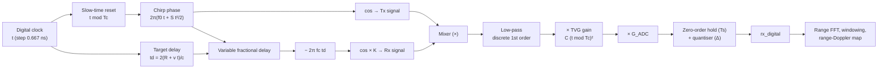
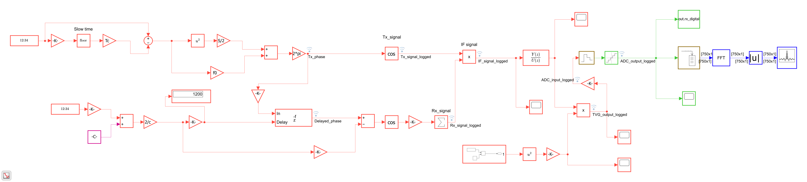
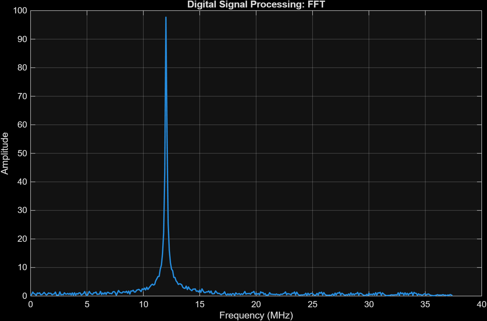
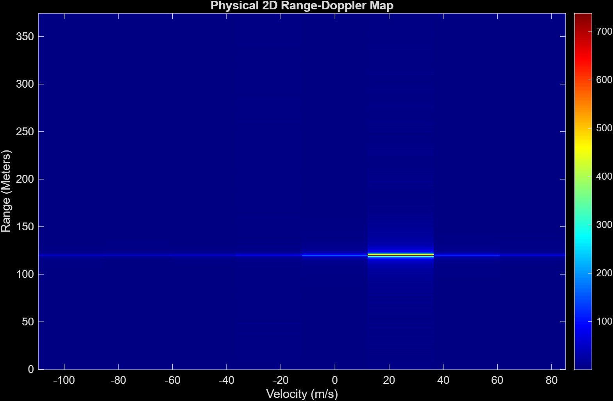
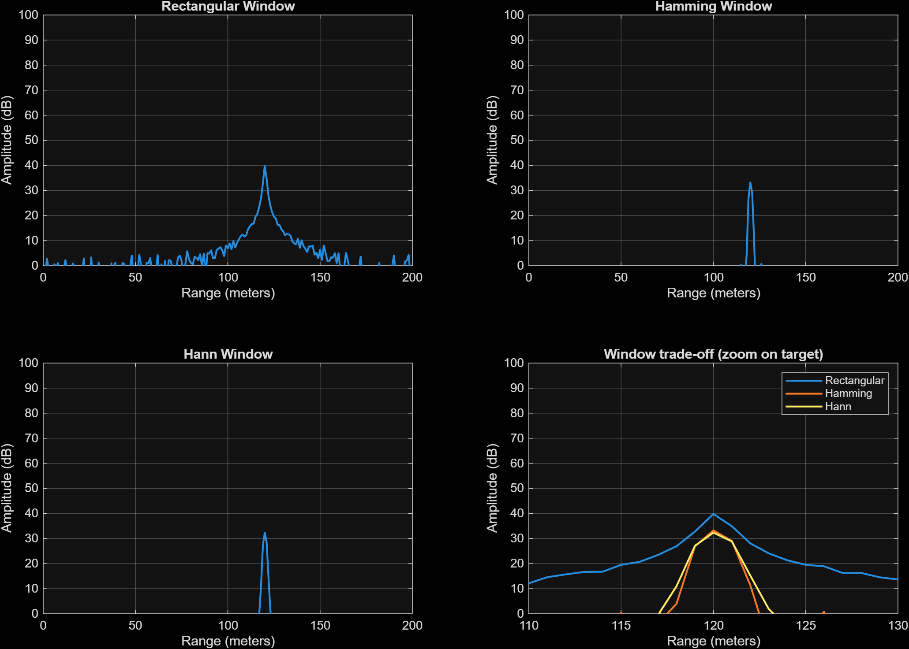
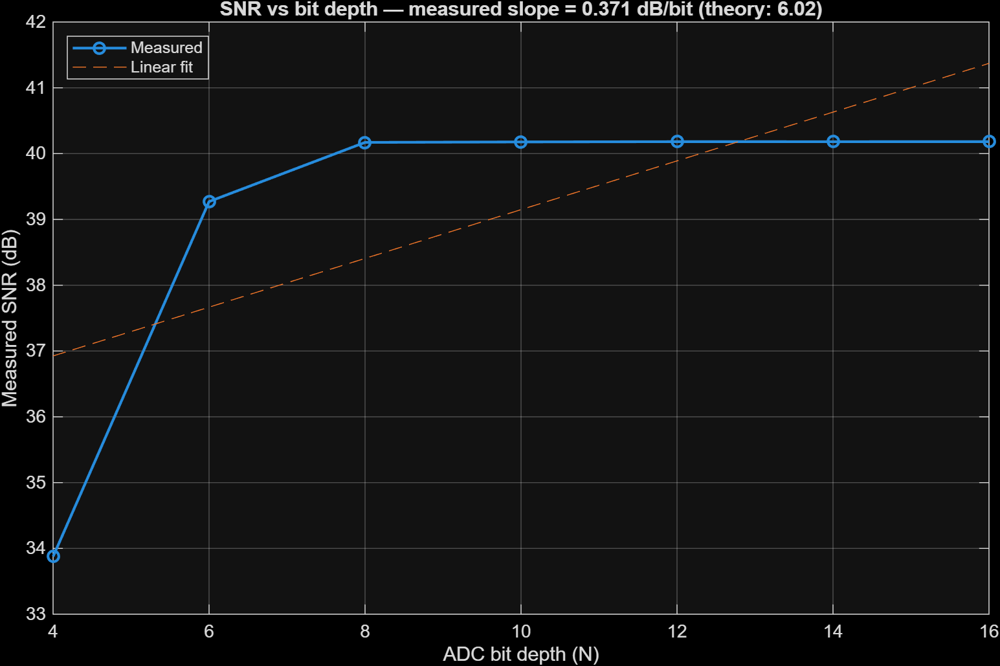

# FMCW Radar Signal Chain (Simulink)

An FMCW radar receiver modelled from first principles in Simulink. A sawtooth chirp is generated from a clock and a phase integral, delayed and attenuated for a moving target with the radar range equation, and mixed with the transmit signal so that range becomes a constant beat frequency. The receive chain then does what a real front end does: low-pass filtering, time-varying gain, an ADC (zero-order hold and N-bit quantiser), a range FFT with window comparison, and a 2D range–Doppler map built from 8 chirps.

There are no Radar Toolbox blocks in the signal path, only gains, sums, trig functions and a variable fractional delay, so every stage can be checked against a formula. Every number in this README was measured by running the model (MATLAB R2026a), and where a result disagrees with theory the documentation says so.

Every stage has its own note in [`docs/`](docs/), numbered in signal-path order. Each one gives the theory, how the block diagram implements it, the measured results and a check table.

---

## Signal chain




*Top level of `Model.slx`. The top row is the chirp, the middle row is the target echo, and the right-hand side is the receiver. 48 blocks including the small subsystem that makes the TVG time base.*

---

## How to run

1. Open MATLAB in this folder.
2. Run `radar_init` to load every parameter into the workspace. The target is set by `R_target`, `v_target` and `RCS`.
3. Run `calibrate_adc_gain` once. It runs the model with `G_ADC_frontend = 1`, measures the peak at the ADC input and sets the gain so the peak sits at 80 % of `V_FSR`.
4. Open `Model.slx` and press **Run**. The stop time is `Tc*N_chirps`, which is 80 µs.
5. Process the result:
   - `process_radar` : range FFT of one chirp, prints beat frequency and range
   - `windowing` : Rectangular vs Hamming vs Hann (peak and floor for the 120 m target)
   - `Range_Doppler_map` : 2D map with physical axes
   - `run_bit_depth_sweep` : SNR versus ADC resolution

Do not `clear` between `calibrate_adc_gain` and `radar_init`: `radar_init` only creates `G_ADC_frontend = 1` if the variable does not exist yet, so the calibrated value is kept.

On my laptop the first run takes a couple of minutes (Simulink has to load) and later runs about a minute.

**Requirements:** MATLAB and Simulink R2026a. The model itself needs no extra toolbox. The scripts use only base MATLAB (the windows are written out as formulas), and the `Buffer`, `FFT` and `Array Plot` blocks come from the DSP System Toolbox. `run_bit_depth_sweep.m` uses `blackmanharris` from the Signal Processing Toolbox.

---

## System parameters

### Inputs (set in `radar_init.m`)

| Parameter | Symbol | Value |
|---|---|---|
| Sweep bandwidth | $B$ | 150 MHz |
| Chirp duration | $T_c$ | 10 µs |
| Chirps per frame | $N_{chirps}$ | 8 |
| Baseband start frequency | $f_0$ | 0 Hz |
| Carrier (used only in the physics) | $f_c$ | 77 GHz ($\lambda$ = 3.896 mm) |
| Model step | $T_{step}$ | $1/(10B)$ = 0.667 ns |
| Maximum design range | $R_{max}$ | 150 m |
| Target range | $R$ | 120 m |
| Target velocity | $v$ | 20 m/s |
| Target RCS | $\sigma$ | 10 m² |
| Antenna gains | $G_{tx}, G_{rx}$ | 100 (20 dB) each |
| ADC | $N_{bits}$, $V_{FSR}$ | 12 bits, 2 |

### Derived quantities

| Quantity | Formula | Value |
|---|---|---|
| Sweep slope | $S = B/T_c$ | $1.5\times10^{13}$ Hz/s |
| Round-trip delay | $t_d = 2R/c$ | 0.8 µs (1200 model steps) |
| Beat frequency | $f_b = S\,t_d$ | 12 MHz |
| Max beat for $R_{max}$ | $S\cdot 2R_{max}/c$ | 15 MHz |
| Filter cutoff | $1.2\,f_{b,max}$ | 18 MHz |
| ADC clock divider | largest divisor of 15000 that is ≤ 20.8 | 20 |
| ADC sample time | $T_s = 20\,T_{step}$ | 13.33 ns ($f_s$ = 75 MHz) |
| Samples per chirp | $N_{samples} = T_c/T_s$ | 750 |
| Range resolution | $c/(2B)$ | 1.0 m |
| Max range in the FFT | $\tfrac{f_s}{2}\cdot\tfrac{c}{2S}$ | 375 m |
| Doppler shift | $f_d = 2v/\lambda$ | 10.27 kHz |
| Doppler phase per chirp | $2\pi f_d T_c$ | 0.645 rad (37°) |
| Velocity resolution | $\lambda/(2N_{chirps}T_c)$ | 24.35 m/s |
| Max unambiguous velocity | $\lambda/(4T_c)$ | ±97.4 m/s |
| Echo amplitude | $K=\sqrt{P_{rx}/P_{tx}}$ | $1.92\times10^{-6}$ (−114.3 dB in power) |
| TVG constant | $C = 10^6/t_{d,max}^2$ | $10^{18}$ |
| ADC quantiser step | $\Delta = V_{FSR}/2^N$ | 4.883e-4 V (12 bits) |

---

## Stages

| # | Note | What it covers |
|---|---|---|
| 01 | [Chirp generation](docs/01-chirp-generation.md) | the slow-time reset, the quadratic phase, what the Tx signal looks like |
| 02 | [Target and echo](docs/02-target-and-echo.md) | delay in model steps, radar-equation amplitude, the Rx phase |
| 03 | [Mixer, filter and TVG](docs/03-mixer-filter-tvg.md) | dechirping, the beat frequency, the low-pass filter and the time-varying gain |
| 04 | [ADC](docs/04-adc.md) | gain calibration, sample and hold, quantiser, error statistics |
| 05 | [Range FFT and windowing](docs/05-range-fft-windowing.md) | beat frequency to range, Rectangular vs Hamming vs Hann |
| 06 | [Range-Doppler map](docs/06-range-doppler-map.md) | 8 chirps, 2D FFT, velocity axis |
| 07 | [Bit-depth sweep](docs/07-bit-depth-sweep.md) | SNR vs ADC bits and why it comes out flat |
| 08 | [Issues and open questions](docs/08-issues-and-open-questions.md) | what looks wrong or unverified, and what was fixed |

All figures are collected in [docs/Images.md](docs/Images.md). Helper scripts used for the notes are in [`docs/scripts/`](docs/scripts/).

---

## Results

| Quantity | Expected | Measured |
|---|---|---|
| Beat frequency | 12.00 MHz | 12.00 MHz |
| Range from the FFT | 120 m | 120.00 m |
| Range–Doppler peak, range | 120 m | 120.00 m |
| Range–Doppler peak, velocity | 20 m/s lies at 0.82 of a bin, so the nearest bin is +24.35 m/s | +24.35 m/s |
| IF amplitude | $K = 1.921\times10^{-6}$ | $1.921\times10^{-6}$ |
| TVG gain at the end of a chirp | $10^{18}\times(10\,\mu s)^2 = 10^8$ | $10^8$ |
| Delay in model steps | 1200 | 1200 |
| 12-bit quantisation error (std) | $\Delta/\sqrt{12}$ = 1.410e-4 V | 1.394e-4 V |
| 4-bit quantisation error (std) | $\Delta/\sqrt{12}$ = 3.608e-2 V | 3.295e-2 V |
| SNR gain per extra ADC bit | 6.02 dB | fitted slope 0.37 dB/bit, flat above 8 bits. See [07](docs/07-bit-depth-sweep.md) |

<p>


</p>

*Left: range FFT of one chirp with the filter fixed, one peak at 12 MHz. Right: range–Doppler map from 8 chirps, peak at 120 m in the +24.35 m/s bin.*

### Effect of the filter fix

Same target, same model, same scripts, with the filter coefficients designed for the original clock (`a = w_c*Ts`) and for the rate the block runs at (`a = w_c*T_step`, now in `radar_init.m`).

| Quantity | Before | After |
|---|---|---|
| Beat frequency / range | 12.00 MHz / 120.00 m | 12.00 MHz / 120.00 m |
| Real filter cutoff | about 300 MHz | 18 MHz |
| Floor away from the target, Rect / Hamming / Hann | 15.2 / 9.5 / 8.4 dB | −2.6 / −10.9 / −11.1 dB |
| Peak − floor, Rect / Hamming / Hann | 26.6 / 25.8 / 26.1 dB | 42.4 / 44.1 / 43.5 dB |
| Bit-depth sweep plateau | 23.5 dB | 40.2 dB |

The "before" window numbers come from the pre-fix run with the Hamming bug corrected, so Hamming is comparable.

### Window comparison (single chirp, target at 120 m, filter fixed)

| Window | Peak (dB) | Median level away from the target (dB) | Peak − floor (dB) |
|---|---|---|---|
| Rectangular | 39.80 | −2.6 | 42.4 |
| Hamming | 33.25 | −10.9 | 44.1 |
| Hann | 32.36 | −11.1 | 43.5 |



## Key findings

1. **Range and beat frequency are exactly right.** 12.00 MHz and 120.00 m, with the echo amplitude, delay and TVG matching the formulas.
2. **The low-pass filter was running at the wrong sample time.** The `Discrete Transfer Fcn` block inherits the model step (0.667 ns), but its coefficients were designed for the ADC clock (13.33 ns). That made the real cutoff about 300 MHz instead of 18 MHz, and the mixer's sum term aliased into the FFT band. `radar_init.m` now uses `a = w_c * T_step`. The range did not change, the noise floor dropped by about 18 dB, and the peak-to-floor gap in the window test went from about 26 dB to about 43 dB. See [03](docs/03-mixer-filter-tvg.md).
3. **A `hamming` function shadowed the toolbox one.** An old `hamming.m` that returns a row vector was on the MATLAB path, which turned the Hamming curve in `windowing.m` into the rectangular curve minus 21.9 dB. `windowing.m` now writes the windows out as formulas. See [05](docs/05-range-fft-windowing.md).
4. **The quantiser behaves as the textbook says.** The error is uniform between ±Δ/2 and its standard deviation matches Δ/√12 to within 1 % at 12 bits.
5. **SNR does not rise with ADC bits.** After the filter fix it plateaus at about 40.2 dB from 8 bits up, instead of gaining 6.02 dB per bit. The ADC is not the limit, but I have not identified what is. See [07](docs/07-bit-depth-sweep.md).
6. **Velocity resolution is only 24.35 m/s** with 8 chirps, so the 20 m/s target lands in the +24.35 m/s bin. This is the resolution limit, not an error.
7. **The ADC output scope looks flat** only because its y-axis is stuck at ±1.4×10⁷. The signal is fine. See [04](docs/04-adc.md).


*SNR against ADC bit depth with the filter fixed.*

## Limitations

- One target only. The blocks are written with vectors (`R_target`, `v_target`, `RCS`, `N_targets`), but only one target has been run.
- No receiver noise source. Every "noise floor" here is leakage, aliasing and quantisation, not thermal noise.
- Baseband simulation. The 77 GHz carrier appears only as the phase term $2\pi f_c t_d$, which carries the Doppler.
- Only 8 chirps per frame, so the velocity axis has 8 bins, 24 m/s apart.
- The first 0.8 µs of each chirp contains the previous chirp's echo and is not blanked.
- The Simulink `Quantizer` does not clip, and it is not settled whether `V_FSR` means the full span or the peak value.
- The TVG ($C\,t^2$) comes from pulsed radar, where time equals range. After dechirping, range is the tone frequency, so every target gets the same gain at any instant. It may not belong in an FMCW chain.
- No detector (CFAR, peak picking). Peaks are read from the plots.
- The sign of the Doppler axis has not been checked with an approaching target.

## Future work

- Re-run `calibrate_adc_gain` and the bit-depth sweep with the corrected filter, then find the cause of the 40 dB plateau
- More chirps (64 to 128) and a window on the Doppler FFT
- CA-CFAR detection, as in the pulse radar
- Several targets and a thermal noise source
- Blank the first $t_d$ of each chirp, and test the model with and without the TVG
- Saturation in the ADC model and a settled definition of `V_FSR`
- Check the Doppler sign with an approaching target

---

## Repository layout

```
.
├── README.md              ← this file
├── Model.slx              the Simulink model
├── radar_init.m           parameters, filter design, ADC clock divider
├── calibrate_adc_gain.m   sets G_ADC_frontend
├── process_radar.m        single-chirp range FFT
├── windowing.m            Rectangular / Hamming / Hann comparison (explicit window formulas)
├── Range_Doppler_map.m    2D range-Doppler processing
├── run_bit_depth_sweep.m  SNR vs ADC bits
└── docs/
    ├── 01 … 08 notes      one per stage, plus issues and open questions
    ├── Images.md          every figure in one page
    ├── images/            screenshots (.jpg) and MATLAB exports (.png)
    └── scripts/           helper scripts used for the notes
                           (plot_logged_signals.m, extra_plots.m)
```

