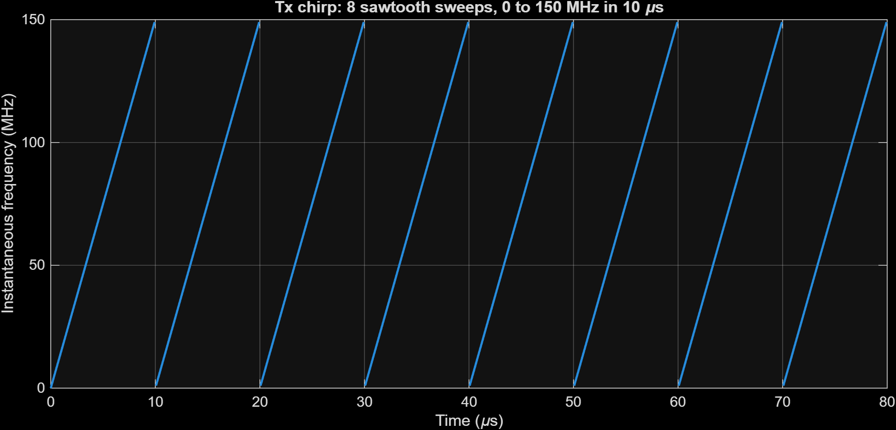
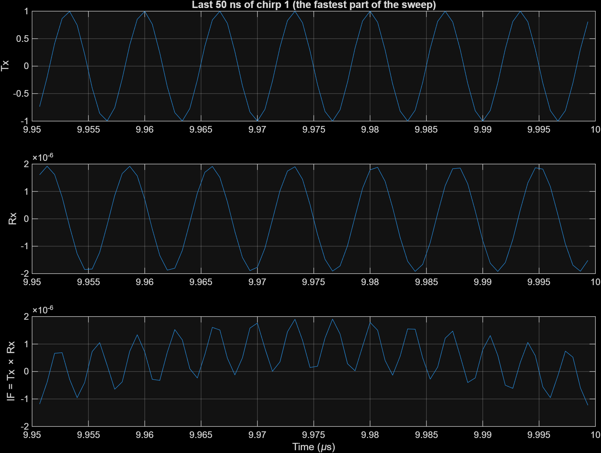

# 01 · Chirp generation

> Makes the transmit signal: a sawtooth frequency sweep that repeats every `Tc`, built from a clock and a phase integral instead of a signal generator block.

**Input:** `Digital Clock` (the global time `t`, step `T_step` = 0.667 ns)
**Output:** `Tx_phase` and `Tx_signal_logged` (logged signals)

*The top row of the model is this note. Left to right: clock, slow-time reset, quadratic phase, 2π, cos.*

---

## Theory

An FMCW radar sends a tone whose frequency goes up linearly with time:

$$ f(t) = f_0 + S\,t, \qquad S = \frac{B}{T_c} $$

The phase is the integral of the frequency (times $2\pi$):

$$ \varphi(t) = 2\pi\int_0^t f(\tau)\,d\tau = 2\pi\left(f_0\,t + \frac{S}{2}\,t^2\right) $$

and the transmitted signal is

$$ s_{tx}(t) = \cos\big(\varphi(t)\big) $$

Here $B$ = 150 MHz and $T_c$ = 10 µs, so

$$ S = \frac{150\times10^{6}}{10\times10^{-6}} = 1.5\times10^{13}\ \text{Hz/s} $$

I use $f_0 = 0$. This is a baseband model, because the sample step is 0.667 ns (1.5 GHz). A 77 GHz carrier can't be simulated at that rate. The carrier is brought back later as a single phase term in the echo, see [02](02-target-and-echo.md).

**Why $T_{step} = 1/(10B)$:** at the end of the sweep the instantaneous frequency is 150 MHz, so one cycle is 6.67 ns, which is exactly 10 model steps. Ten samples per cycle looks smooth enough. You can see this in the zoomed Tx plot below.

---

## How the block diagram works

1. **Digital Clock** gives absolute time $t$ with step `T_step`.
2. **Slow-time reset.** The chain `Gain (1/Tc) → floor → Gain (Tc)` computes $T_c\lfloor t/T_c\rfloor$, the start time of the current chirp. A sum block subtracts it from $t$:

$$ t_{fast} = t - T_c\left\lfloor \frac{t}{T_c} \right\rfloor $$

   so $t_{fast}$ is a sawtooth from 0 to $T_c$ that restarts at every chirp. The model calls this the "slow time" reset. The label on the diagram says "Slow time" but it is really the *fast-time* coordinate inside a chirp. The index of the chirp is the slow time.
3. **Quadratic term.** A `Math Function` (square) makes $t_{fast}^2$ and a gain `S/2` scales it.
4. **Linear term.** A gain `f0` times $t_{fast}$ (zero here since $f_0 = 0$).
5. A sum block adds them, a gain `2*pi` multiplies, and that is `Tx_phase`.
6. A `Trigonometric Function` block (cos) gives `Tx_signal_logged`.

Resetting the time makes the phase jump back to 0 at the start of every chirp, so the signal is not phase-continuous between chirps. That is fine for dechirping.

---

## What it looks like

*Instantaneous frequency of the Tx chirp, taken from `diff(Tx_phase)/dt/2π`. Eight sawtooth ramps, each 0 → 150 MHz in 10 µs. Maximum measured value: 149.995 MHz. (I masked the one-sample reset spike at the end of every chirp. Without the mask the spike is 10⁵ MHz and the ramps look flat.)*

*Top panel: the Tx signal in the last 50 ns of chirp 1. The period is about 6.7 ns (150 MHz), 10 samples per cycle, as designed. The Rx and IF panels are explained in [02](02-target-and-echo.md) and [03](03-mixer-filter-tvg.md).*

---

## Check

| Quantity | Expected | Measured |
|---|---|---|
| Sweep slope $S$ | $1.5\times10^{13}$ Hz/s | from `radar_init`: $1.5\times10^{13}$ |
| Maximum frequency | 150 MHz | 149.995 MHz |
| Number of chirps in 80 µs | 8 | 8 (see plot) |
| Samples per cycle at 150 MHz | 10 | about 10 (period 6.7 ns) |

---

[Index](../README.md) · [02 Target and echo →](02-target-and-echo.md)
