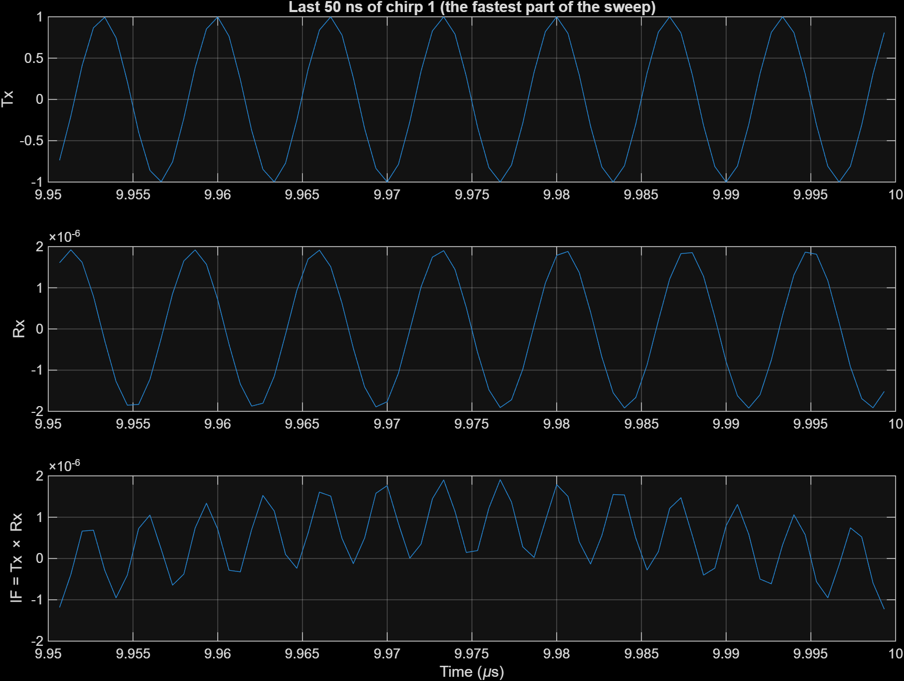

# 02 · Target and echo

> Makes the received signal: the transmit chirp delayed by the round-trip time, scaled by the radar equation, with the carrier phase and the Doppler added.

**Input:** `Tx_phase` from [01](01-chirp-generation.md), the second clock, target arrays `R_target`, `v_target`, `RCS`
**Output:** `Rx_signal_logged`

*The middle row of the model. Left: clock, velocity gain, range constant, 2/c. Centre: the Variable Fractional Delay. Right: subtract the carrier phase, cos, gain, sum.*

---

## Theory

### Delay

A target at range $R$ moving at radial velocity $v$ (positive = moving away) has a range that changes with time, $R(t) = R + v\,t$. The wave goes there and back, so

$$ t_d(t) = \frac{2\,(R + v\,t)}{c} $$

For my target, $R$ = 120 m and $v$ = 20 m/s:

$$ t_d = \frac{2\times120}{3\times10^{8}} = 0.8\ \mu s \;=\; \frac{0.8\times10^{-6}}{0.667\times10^{-9}} = 1200 \text{ model steps} $$

The `Display` block in the model shows exactly 1200 (see the screenshot in [Images](Images.md)). Over a whole 80 µs frame the target moves $20\times80\times10^{-6}$ = 1.6 mm, so the delay barely changes (by 0.016 of a sample). The velocity only matters through the carrier phase, below.

### Echo phase

The echo is the chirp as it was $t_d$ ago, with an extra phase from the 77 GHz carrier:

$$ \varphi_{rx}(t) = \varphi_{tx}\big(t - t_d\big) \;-\; 2\pi f_c\,t_d $$

$$ s_{rx}(t) = K\cos\big(\varphi_{rx}(t)\big) $$

The second term is tiny in amplitude terms but huge in phase terms. With $f_c$ = 77 GHz and $t_d = 2(R+vt)/c$, it contains $-2\pi f_c\,2vt/c$, which is a frequency shift of

$$ f_d = \frac{2 v}{\lambda} = \frac{2\times20}{3.896\times10^{-3}} = 10.27\ \text{kHz} $$

That is the Doppler shift. It is the only way the velocity enters the model, so it is what the range-Doppler map ([06](06-range-doppler-map.md)) measures.

### Amplitude (radar equation)

$$ \frac{P_{rx}}{P_{tx}} = \frac{G_{tx}\,G_{rx}\,\lambda^{2}\,\sigma}{(4\pi)^{3}R^{4}} \qquad\Rightarrow\qquad K = \sqrt{\frac{P_{rx}}{P_{tx}}} $$

With $G_{tx} = G_{rx} = 100$, $\lambda$ = 3.896 mm, $\sigma$ = 10 m², $R$ = 120 m:

| Piece | Value |
|---|---|
| $G_{tx}G_{rx}$ | $10^4$ |
| $\lambda^2$ | $1.518\times10^{-5}$ m² |
| $(4\pi)^3$ | 1984.4 |
| $R^4$ | $2.074\times10^{8}$ m⁴ |
| $P_{rx}/P_{tx}$ | $3.689\times10^{-12}$ ($-114.3$ dB) |
| $K$ | $1.921\times10^{-6}$ |

So the echo is about two millionths of the transmit amplitude. That tiny number is why the TVG and ADC gain exist later.

---

## How the block diagram works

1. **Digital Clock1 → Gain (`v_target`)** gives $v\,t$. A sum block adds `Constant1` (`R_target`), so the output is $R + v t$. A gain `2/c` turns it into $t_d(t)$ in seconds.
2. A gain `1/T_step` converts seconds into samples. The `Display` block shows 1200 here. This feeds the **Delay** port of the `Variable Fractional Delay` block (maximum delay `D_max_samples` = 1001 samples, linear interpolation).
3. `Tx_phase` goes through a gain `ones(1,N_targets)` that copies it onto one channel per target, then into the **In** port of the delay block. So I am delaying the *phase*, not the cosine. The output is `Delayed_phase` = $\varphi_{tx}(t - t_d)$.
4. In parallel, $t_d$ goes through a gain `2*pi*fc`, giving $2\pi f_c t_d$.
5. A sum block subtracts it from `Delayed_phase`, giving $\varphi_{rx}$.
6. `cos`, then a gain `K_target`, then `Sum of Elements`, which adds the echoes of all targets into one signal. With one target it just passes the signal through.

Delaying the phase is much cheaper than delaying a 77 GHz signal. It is also exact for the chirp part. For several targets nothing in the structure has to change, since every gain and constant is already a vector, but I have only run N = 1.

**Echo of the previous chirp.** Because the phase is delayed, the first 0.8 µs of every chirp still contains the end of the *previous* chirp's echo, which is physically correct. In the mixer ([03](03-mixer-filter-tvg.md)) this gives a short stretch (8 % of the chirp) with a different beat frequency. I did not blank it. It is one of the reasons the FFT peak is not perfectly clean.

---

## What it looks like

*Middle panel: the Rx signal over the last 50 ns of chirp 1. The amplitude is about $2\times10^{-6}$, as predicted by $K = 1.921\times10^{-6}$. The frequency is slightly lower than in the Tx panel because the echo is the chirp as it was 0.8 µs ago, when the frequency was 12 MHz lower.*

---

## Check

| Quantity | Expected | Measured |
|---|---|---|
| Delay in samples | 1200 | 1200 (Display block) |
| Max delay needed (`D_max_samples`) | ⌈(2·150.0016/c)/T_step⌉ = 1001 | set from `radar_init` |
| Echo amplitude $K$ | $1.921\times10^{-6}$ | peak of the IF signal is $1.921\times10^{-6}$ (since Tx amplitude is 1) |
| Doppler shift | 10.27 kHz | not measured directly; it appears as the Doppler-bin position in [06](06-range-doppler-map.md) |

---

[← 01 Chirp generation](01-chirp-generation.md) · [Index](../README.md) · [03 Mixer, filter and TVG →](03-mixer-filter-tvg.md)
