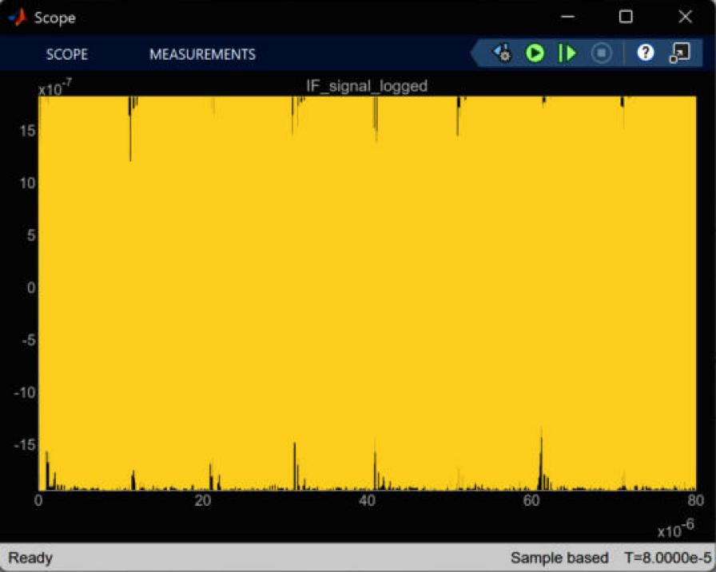
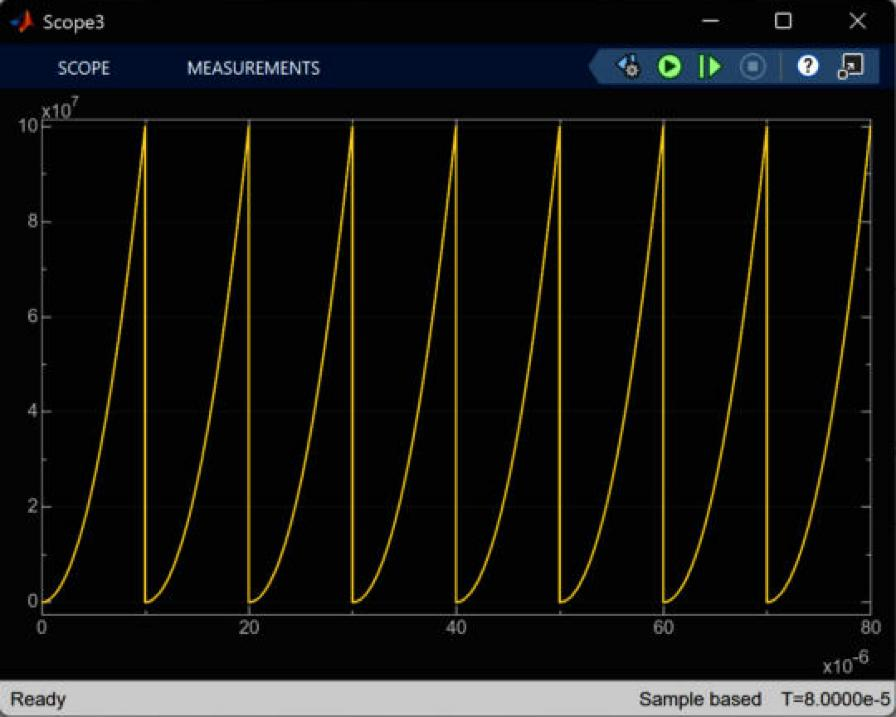
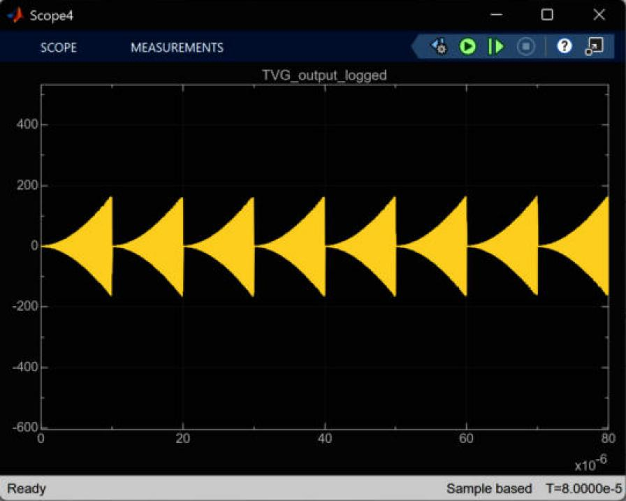
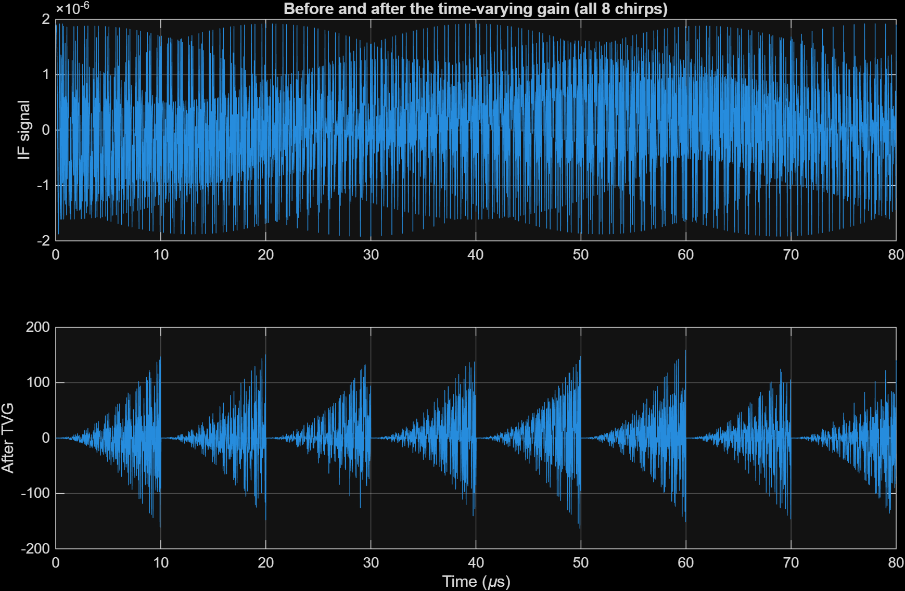

# 03 · Mixer, low-pass filter and TVG

> Multiplies the received signal by the transmitted one so that each target turns into a constant-frequency beat tone, filters out the unwanted mixer product, and applies a time-varying gain.

**Input:** `Tx_signal_logged`, `Rx_signal_logged`
**Output:** `IF_signal_logged` → low-pass → `TVG_output_logged`

*The right-hand part of the model: the `x` mixer, the `Y(z)/U(z)` filter block, and below it the TVG chain (a small subsystem, `u²`, a gain and a second `x`).*

---

## Theory

### The mixer (dechirp)

Multiply the two cosines:

$$ s_{tx}\,s_{rx} = K\cos(\varphi_{tx})\cos(\varphi_{rx}) = \frac{K}{2}\Big[\cos(\varphi_{tx}-\varphi_{rx}) + \cos(\varphi_{tx}+\varphi_{rx})\Big] $$

The difference term is the one we want. With $f_0 = 0$ and $\varphi_{rx}(t) = \varphi_{tx}(t-t_d) - 2\pi f_c t_d$:

$$ \varphi_{tx}(t)-\varphi_{rx}(t) = 2\pi\left( S\,t_d\,t \;-\; \frac{S\,t_d^{2}}{2} \;+\; f_c\,t_d \right) $$

This is a pure tone in $t$, with frequency

$$ f_b = S\,t_d = \frac{2 S R}{c} $$

For $R$ = 120 m: $f_b = 1.5\times10^{13}\times0.8\times10^{-6}$ = 12 MHz. The range is now a frequency, which the FFT can read. The constant term $2\pi f_c t_d$ carries the Doppler: from one chirp to the next, $t_d$ changes by $2vT_c/c$, which moves this phase by $2\pi f_d T_c$ = 0.645 rad (37°).

The sum term sits at roughly $2St$, from 0 to 300 MHz. It has to be removed before the ADC.

**Amplitude check.** The beat tone itself has amplitude $K/2$ = $0.96\times10^{-6}$. The instantaneous maximum of the whole product, when both terms line up, is $K$ = $1.921\times10^{-6}$. The peak of `IF_signal_logged` that I measured is $1.921\times10^{-6}$, so the mixer is doing what the formula says.

### The low-pass filter

The model has a discrete first-order low-pass. `radar_init.m` designs it from the analogue filter

$$ H(s) = \frac{\omega_c}{s+\omega_c}, \qquad f_c = 1.2\,f_{b,max} = 1.2\times15\text{ MHz} = 18\text{ MHz} $$

using the Tustin (bilinear) substitution $s = \frac{2}{T}\frac{1-z^{-1}}{1+z^{-1}}$, which with $a = \omega_c T$ gives

$$ H(z) = \frac{a}{2+a}\;\frac{1+z^{-1}}{1-\frac{2-a}{2+a}\,z^{-1}} $$

In `radar_init.m` the sample time used is $T = T_s$ = 13.33 ns (the ADC clock), so $a$ = 1.508, numerator `[0.430 0.430]`, denominator `[1 -0.140]`.

### The TVG

$$ G_{TVG}(t) = C\,t_{fast}^{2}, \qquad C = \frac{G_{max}}{t_{d,max}^{2}} = \frac{10^{6}}{(1\ \mu s)^{2}} = 10^{18} $$

where $t_{fast}$ is the time since the start of the current chirp. The idea (from the radar equation) is that echo *power* falls as $1/R^4$, so echo *amplitude* falls as $1/R^2$, so a gain growing as $R^2$ evens it out. Gain is 60 dB at $t_{d,max}$ = 1 µs and $10^8$ (80 dB) at the end of the chirp.

---

## How the block diagram works

1. `Product` multiplies `Tx_signal` and `Rx_signal`, giving `IF_signal_logged`.
2. `Discrete Transfer Fcn` (num `num_d`, den `den_d`) filters it. Its output also goes to two scopes (`Scope`, `Scope1`).
3. The TVG time base is a `Subsystem`: a `Digital Clock`, a `mod` block with the constant `Tc`, and an Outport, so it gives $t_{fast}$. After it come `u²` (Math Function), a gain `C_TVG`, and a second `Product` that multiplies the filtered IF by $G_{TVG}$. The result is `TVG_output_logged`.
4. After that, the signal goes to the ADC, see [04](04-adc.md).

---

## What it looks like

*Screenshot of the Simulink scope on the filter output. The yellow block is the 80 µs of signal drawn at full density, amplitude about ±1.9e-6.*

*Scope 3: the TVG gain $C\,t_{fast}^2$. It is a parabola that resets every 10 µs and reaches $10^8$ at the end of each chirp, matching $10^{18}\times(10\,\mu s)^2$.*

*Scope 4: the signal after the TVG. Eight triangular bursts. The amplitude grows with time inside each chirp, up to about ±160 before the ADC gain is applied.*

*Top: the IF signal over all 8 chirps. Bottom: the same after the TVG. I plotted every 50th sample to keep the figure light, so the top panel is aliased and should only be trusted for the envelope. The bottom shows the bursts clearly: the peak after the TVG is 163.88 when the ADC gain is 1.*

---

## Problem: the filter runs at the wrong sample rate

When I looked at the block parameters (the dump is in `docs/scripts/model_block_dump.txt`), the `Discrete Transfer Fcn` has `SampleTime = -1`, which means *inherit*. I compiled the model and asked Simulink for the real rates:

| Block | Compiled sample time |
|---|---|
| Digital Clock | 0.667 ns (`T_step`) |
| **Discrete Transfer Fcn** | **0.667 ns** |
| Zero-Order Hold | 13.33 ns (`Ts`) |
| Quantizer | 13.33 ns (`Ts`) |

So the filter is computed every 0.667 ns, but its coefficients were designed for 13.33 ns. A digital filter with fixed coefficients has a fixed *normalised* cutoff. Run 20 times faster, its cutoff moves up by 20 times too. I evaluated $|H|$ at both rates:

| Frequency | If it ran at $T_s$ = 13.33 ns (as designed) | As it really runs at $T_{step}$ = 0.667 ns |
|---|---|---|
| 12 MHz | −1.85 dB | 0.00 dB |
| 18 MHz | −4.07 dB | −0.01 dB |
| 100 MHz | (above Nyquist, not meaningful) | −0.33 dB |
| 150 MHz | (above Nyquist) | −0.74 dB |
| 300 MHz | (above Nyquist) | −2.85 dB |

At the rate it really runs at, the −3 dB corner is around 300 MHz. It does almost nothing to the mixer's sum term (0 to 300 MHz). That term then goes straight into a zero-order hold that samples at only 75 MHz, so it aliases down into the 0 to 37.5 MHz band that the FFT looks at.

Even the *designed* filter is a bit off: at 18 MHz it gives −4.07 dB, not −3 dB, because I did not pre-warp the bilinear transform. That is a smaller problem.

**Test.** I re-ran the bit-depth sweep with the filter coefficients recomputed for $T_{step}$ (`a = w_c*T_step`), changing nothing else (`run_bit_depth_sweep.m` now picks this up through `radar_init.m`). The SNR plateau rose from 23.5 dB to 40.2 dB. Details in [07](07-bit-depth-sweep.md). The model itself is unchanged; the fix is one line in `radar_init.m`.

---

## One more question about the TVG

In a pulsed radar, "time since the pulse" is the same thing as range, so a gain that grows with time compensates the $1/R^4$ loss. After dechirping in an FMCW radar, range is the *frequency* of the tone, not the time. The TVG, as built, multiplies every target by the same $t_{fast}^2$ at any instant, so it cannot give a far target more gain than a near one. All it does here is amplitude-modulate the 12 MHz tone, which spreads its spectrum a little. I am not sure this block belongs in an FMCW chain. I have put it in [08](08-issues-and-open-questions.md) as something to check rather than something I can claim is wrong.

---

## Check

| Quantity | Expected | Measured |
|---|---|---|
| Beat frequency | 12 MHz | 12.00 MHz (FFT, [05](05-range-fft-windowing.md)) |
| Max of IF signal | $K = 1.921\times10^{-6}$ | $1.921\times10^{-6}$ |
| TVG at the end of a chirp | $10^8$ | $10^8$ (Scope 3) |
| Peak after TVG (ADC gain = 1) | not predicted | 163.88 |
| Filter sample time | 13.33 ns (design) | 0.667 ns (compiled) ← mismatch |

---

[← 02 Target and echo](02-target-and-echo.md) · [Index](../README.md) · [04 ADC →](04-adc.md)
