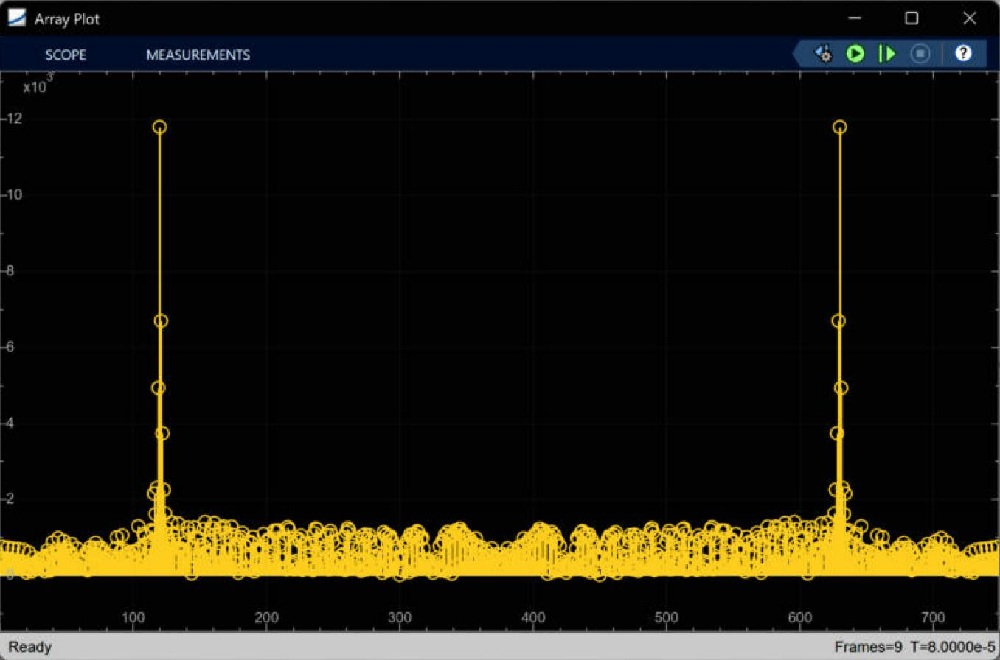
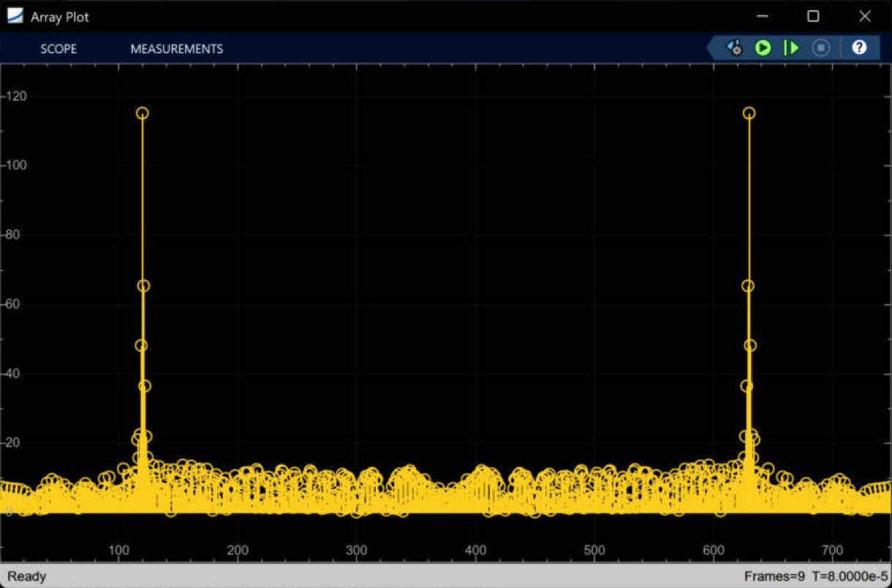
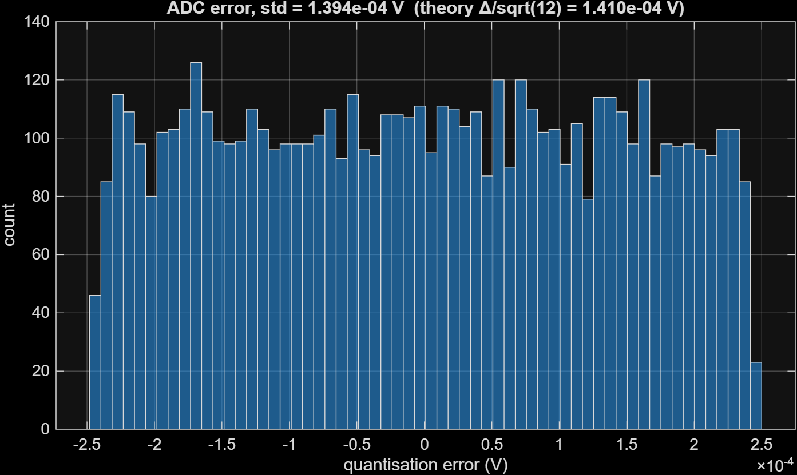
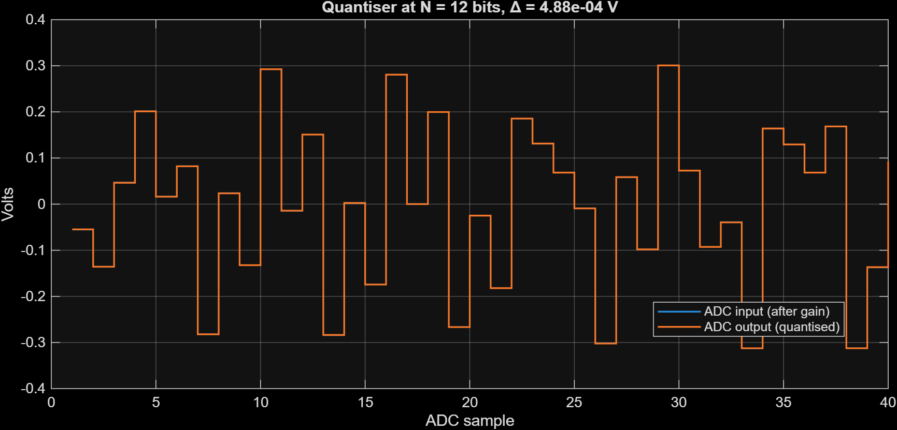
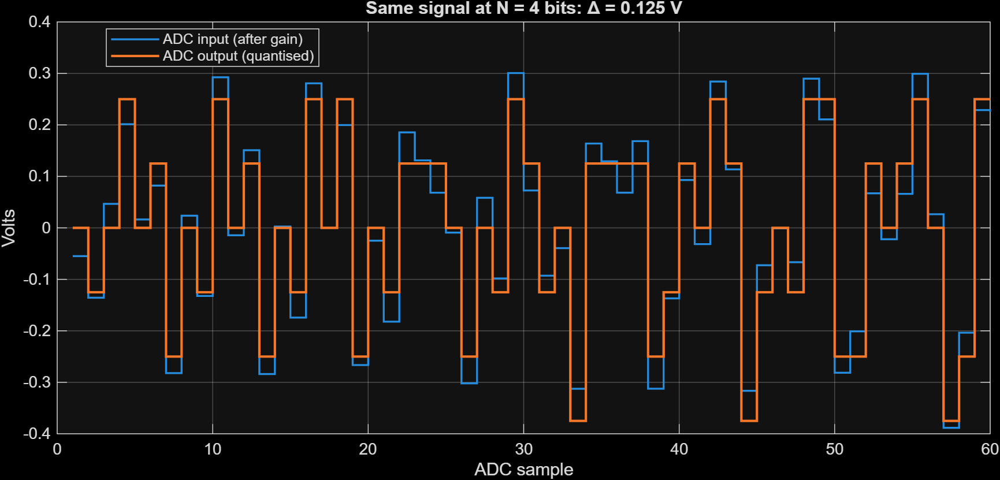
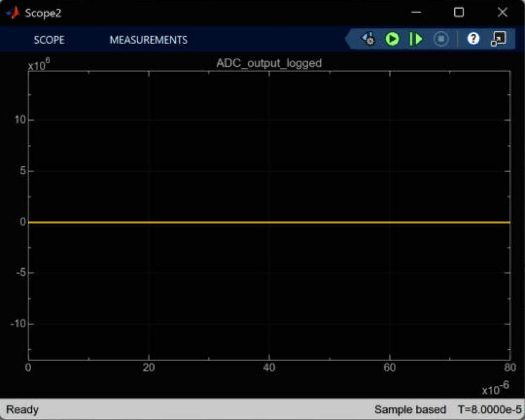

# 04 · ADC

> Scales the signal to fit the ADC, samples it at 75 MHz, rounds it to N bits, and logs the result as `rx_digital` for the MATLAB scripts.

**Input:** `TVG_output_logged` from [03](03-mixer-filter-tvg.md)
**Output:** `ADC_output_logged` → `out.rx_digital` (6001 values), and the live FFT in the `Array Plot`

*The ADC is the cluster just right of the TVG product: the `-K-` gain (`G_ADC_frontend`), the staircase icon (zero-order hold), the quantiser icon, then the `To Workspace` block and the buffer/FFT/`|u|`/Array Plot chain.*

---

## Theory

### Sampling

The model runs every $T_{step}$ = 0.667 ns, far faster than any real ADC. `radar_init.m` picks a slower ADC clock like this:

1. The filter cutoff is 18 MHz, so the ideal sample rate is $f_{s,ideal} = 2\cdot f_{cutoff}\cdot 2$ = 72 MHz (the second 2 is an oversampling factor), i.e. $T_{s,ideal}$ = 13.89 ns, or 20.83 model steps.
2. The ADC clock must be a whole number of model steps and must divide the chirp evenly. The chirp is 15000 steps, so the divider has to be a divisor of 15000. The largest one at or below 20.83 is **20**.
3. So $T_s = 20\,T_{step}$ = 13.33 ns, $f_s$ = 75 MHz, and $N_{samples} = 15000/20$ = **750** samples per chirp.

With 750 samples and $f_s$ = 75 MHz, the FFT bins are 100 kHz apart, which is exactly 1 m of range per bin. That is why the range axis comes out in whole metres.

### Quantising

An $N$-bit ADC with full-scale range $V_{FSR}$ has step

$$ \Delta = \frac{V_{FSR}}{2^{N}} $$

(for 12 bits and $V_{FSR}$ = 2: $\Delta$ = 4.883e-4 V). The quantiser rounds each sample to the nearest multiple of $\Delta$. The rounding error is uniform between $-\Delta/2$ and $+\Delta/2$, so its standard deviation is

$$ \sigma_q = \frac{\Delta}{\sqrt{12}} $$

and for a full-scale sine the best possible SNR is

$$ \text{SNR}_{ideal} = 6.02\,N + 1.76\ \text{dB} \qquad (74\ \text{dB for } N = 12) $$

### Gain calibration

The signal after the TVG peaks at about 164 (in model units), but the ADC range is only ±1 or ±2. So a gain `G_ADC_frontend` is put in front of it. `calibrate_adc_gain.m` does this in two passes:

$$ G_{ADC} = \frac{0.8\,V_{FSR}}{\max|x_{TVG}|} = \frac{0.8\times2}{163.88} = 0.009763 $$

Pass 1 runs the model with $G_{ADC}$ = 1 to measure the peak. Pass 2 uses it. The 0.8 is 20 % headroom.

---

## How the block diagram works

1. `Gain7` (`G_ADC_frontend`) scales the signal. Its output is logged as `ADC_input_logged`, at the fast model rate (120001 points over 80 µs).
2. `Zero-Order Hold` with `SampleTime = Ts` picks a value every 13.33 ns and holds it.
3. `Quantizer` with interval `Delta_q` rounds it. Its output is `ADC_output_logged` (6001 points, the extra one being the sample at t = 0).
4. `To Workspace1` saves it as `rx_digital` (array format, no decimation).
5. `Buffer` (N = `N_samples`) groups the stream into 750-sample frames, `FFT` transforms each one, `Complex to Magnitude-Angle` takes $|X|$, and the `Array Plot` shows it.

The Simulink `Quantizer` block only rounds. It does **not** saturate. That matters for the next section.

---

## Results

### Calibration

| | $G_{ADC}$ = 1 (first run) | $G_{ADC}$ = 0.009763 (calibrated) |
|---|---|---|
| Max of `rx_digital` | 163.01 | 1.5915 |
| Distinct output levels used | 5723 | 4976 |
| Array Plot peak (frame 9) | $1.18\times10^4$ | about 115 |
| Range–Doppler peak magnitude | $9.279\times10^4$ | $9.060\times10^2$ |

The ratio of the two range–Doppler peaks is 0.009763, so the calibration just rescales the numbers without changing anything else. The first run had an ADC input of 164 on a ±1 V or ±2 V converter. A real ADC would have clipped it completely, but this model's quantiser does not clip, which is why that run still gave a clean result.

*Array Plot after the first run ($G_{ADC}$ = 1). The two symmetric peaks are the positive and negative frequency of the 12 MHz tone (bins 120 and 630 out of 750). Vertical scale: ×10³.*

*Same plot after calibration. The shape is identical and the scale is about 100 times smaller.*

### Quantisation error

I compared the ADC output to the ADC input at the same instants (the input is logged at the fast rate, so I resampled it at the ADC clock times with a hold).

| N | $\Delta$ (V) | Theory $\Delta/\sqrt{12}$ | Measured std | Max abs error |
|---|---|---|---|---|
| 12 | 4.883e-4 | 1.410e-4 V | 1.394e-4 V | 2.441e-4 V = $\Delta/2$ |
| 4 | 0.125 | 3.608e-2 V | 3.295e-2 V | not recorded |

*Histogram of the 12-bit quantisation error over one frame. It is flat between $\pm\Delta/2$ = ±2.44e-4 V, as the uniform-error model says.*

*40 consecutive ADC samples at 12 bits. The input and output lines lie on top of each other, because $\Delta$ is 0.5 mV and the signal is hundreds of mV. The blue line is hidden underneath.*

*The same signal at 4 bits ($\Delta$ = 0.125 V). Now the orange quantised output is clearly a staircase around the blue input. The measured error (3.3e-2 V) is 9 % smaller than $\Delta/\sqrt{12}$. My guess is that the signal is only a few steps tall here (±0.3 V against $\Delta$ = 0.125 V), so the error is no longer spread evenly over $\pm\Delta/2$. I have not tested that.*

So the quantiser block behaves as the textbook says.

---

## A flat scope that is not a problem

*Screenshot of `Scope2` (the ADC output scope). It shows a flat line at zero.*

This looked like a bug at first. It is not. The scope has a manual y-axis of about −1.35×10⁷ to +1.49×10⁷ (I read this from the block parameters), left over from some earlier version. The real signal, ±1.6, is a hair-thin line at zero on that scale. The proper views of the ADC output are the zoom plots above and the FFT.

---

## Open question: what does `V_FSR` mean?

`Delta_q = V_FSR/2^N` is the usual formula when $V_{FSR}$ is the *whole span* of the converter, for example ±1 V for $V_{FSR}$ = 2. But `calibrate_adc_gain.m` sets the *peak* to $0.8\,V_{FSR}$ = 1.6, which would be outside a ±1 V span. If $V_{FSR}$ is the span, the calibrated peak should be $0.8\times V_{FSR}/2$ = 0.8, and the gain should be half as large. Since the `Quantizer` block never clips, the model cannot show the difference. It is listed in [08](08-issues-and-open-questions.md).

---

[← 03 Mixer, filter and TVG](03-mixer-filter-tvg.md) · [Index](../README.md) · [05 Range FFT and windowing →](05-range-fft-windowing.md)
