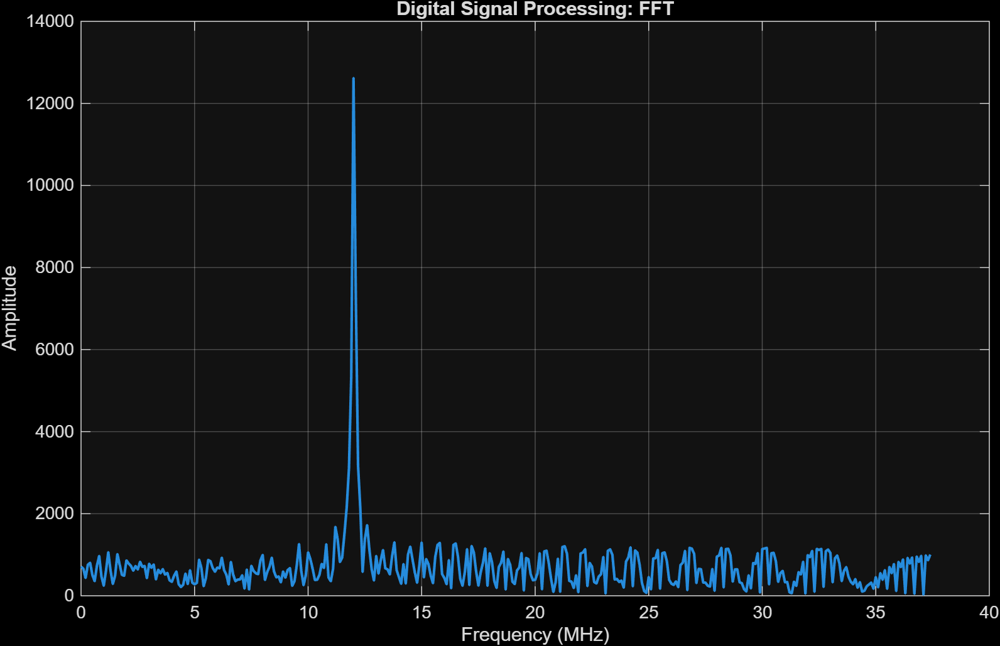
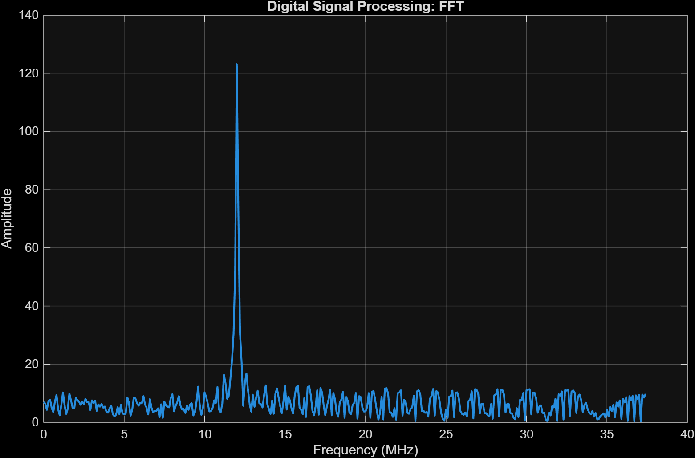
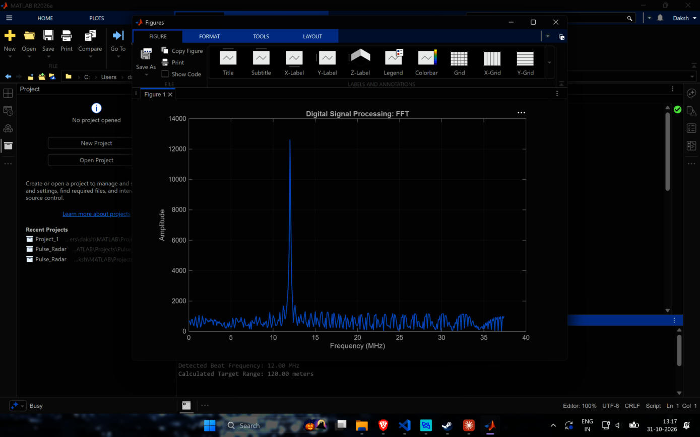
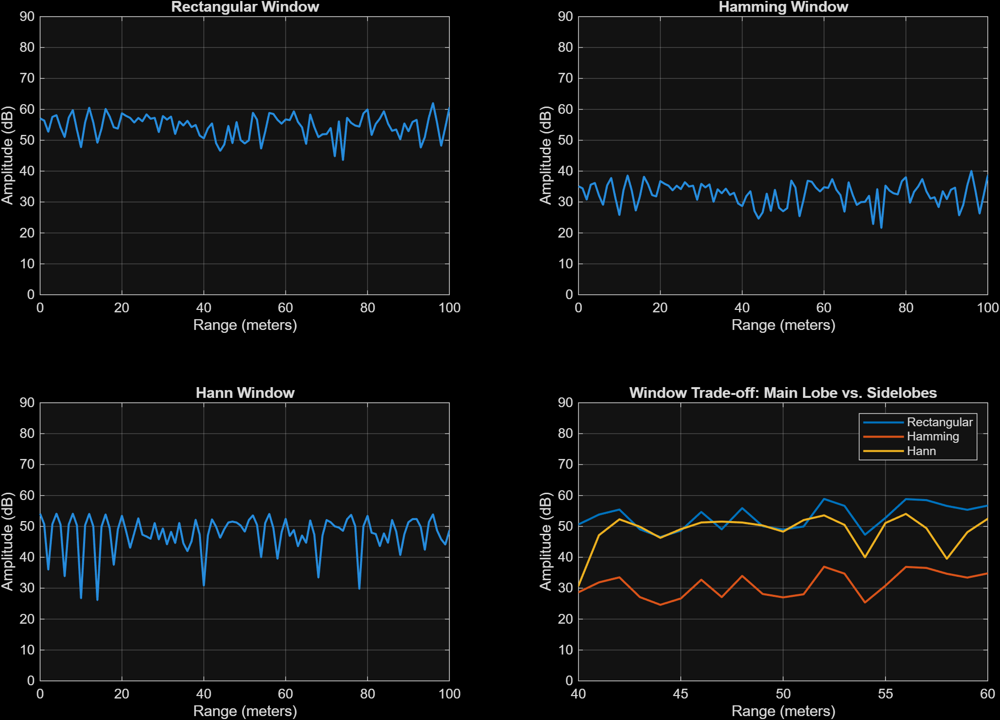
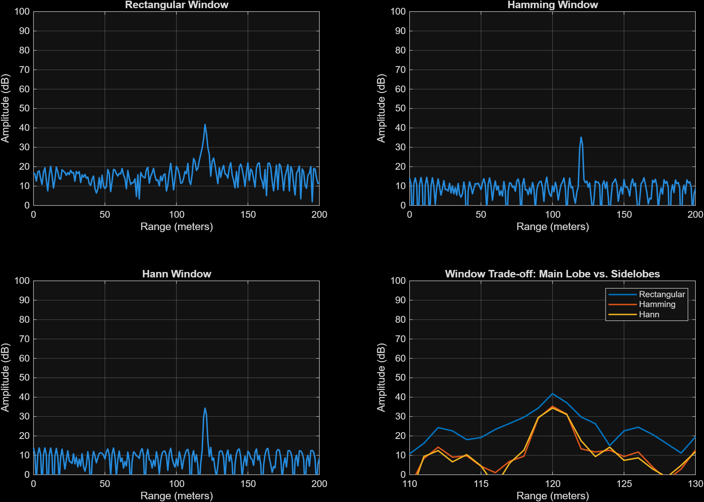

# 05 · Range FFT and windowing

> Takes one chirp of `rx_digital` (750 samples), runs an FFT and turns the peak frequency into a range. Then compares Rectangular, Hamming and Hann windows on the same chirp.

**Input:** `out.rx_digital` from [04](04-adc.md)
**Output:** beat frequency, range, and a window comparison (scripts `process_radar.m`, `windowing.m`)

---

## Theory

### Frequency bin to range

After dechirping, every target is a tone at $f_b = S\,t_d = 2SR/c$, so

$$ R = \frac{f_b\,c}{2S} $$

The FFT of $N$ = 750 samples at $f_s$ = 75 MHz has bins spaced

$$ \Delta f = \frac{f_s}{N} = \frac{75\times10^{6}}{750} = 100\ \text{kHz} $$

and one bin is $\Delta R = \Delta f\,c/(2S)$ = 1 m. This is the same as the textbook range resolution $c/(2B)$ = 1 m, because the chirp is exactly 750 samples long and sweeps 150 MHz. So the 12 MHz tone sits in bin 120 exactly (bin 0 is DC).

Only the first half of the FFT is used (bins 0 to 374) because the signal is real, so the second half is the mirror image. That gives 375 m of range, matching the number in the README.

### Why use a window

The FFT assumes the 750 samples repeat forever. If the tone does not fit a whole number of cycles, the sharp ends of the chirp leak energy into every other bin. A window tapers the ends to reduce the leakage, but it also makes the main lobe wider and the peak lower:

$$ x_w[n] = x[n]\,w[n] $$

| Window | Sum of $w$ (coherent gain × N) | Peak, calibrated run |
|---|---|---|
| Rectangular | 750.0 | 41.81 dB |
| Hamming | 404.5 | 35.30 dB |
| Hann | 374.5 | 34.42 dB |

The drop in peak should be about $20\log_{10}(\text{sum}\,w/N)$: Hamming −5.4 dB and Hann −6.0 dB for a tone with constant amplitude. I measured −6.5 dB and −7.4 dB. The extra 1 to 1.4 dB comes from the TVG ([03](03-mixer-filter-tvg.md)): the amplitude grows like $t^2$ so most of the energy is in the last part of the chirp, where the window is small. I checked this by looking at the rms of the signal in three thirds of the chirp: 0.045, 0.261, 0.632. That is my explanation and it matches the sign and size of the gap, but I did not test it by turning the TVG off.

---

## Results

### `process_radar.m`

```
Detected Beat Frequency: 12.00 MHz
Calculated Target Range: 120.00 meters
```


*Range FFT (rectangular window, no calibration, G_ADC = 1). One peak at 12 MHz. The mirror at 63 MHz is cut off by `half_length`.*


*After the ADC gain calibration. Same shape, scale ×0.0098.*


*A real screenshot of the MATLAB figure.*

### Windowing

The original `windowing.m` has the x-axis limited to 0 to 50 m, which was the old target. With the target at 120 m, that plot only shows the noise floor (this is image 10). So `windowing.m` now uses `xlim([0 200])` and a zoom of 110 to 130 m in the fourth panel.


*Original `windowing.m` output: only noise, because the target is at 120 m and the axis stops at 50 m. Ignore the Hamming curve in this picture (see the bug below).*

#### Bug: my first Hamming curve was wrong

On my first run with the axes fixed, the Hamming plot was just the rectangular plot pushed down by 21.9 dB. I thought that was strange, since 82.02 − 21.94 = 60.08 and a real Hamming window should only cost 5 or 6 dB. So I printed the window:

```
hamming: 0.08 0.999996 0.08 sum=404.54
```

The numbers (min 0.08, max 1, sum 404.5) are right, but the script was multiplying a *column* `raw_signal` by `windows{i}` and one of them is a row. MATLAB then broadcasts a 750×1 against a 1×750 into a 750×750 matrix, and `fft(..., N_samples)` of that matrix works column by column. I only noticed because `which hamming` pointed to

```
C:\Users\daksh\Downloads\SAR Project\...\mlradar\libs\ambiguity\hamming.m
```

which is a function from an old SAR project that is on my MATLAB path and returns a **row** vector. It shadows the Signal Processing Toolbox one, which returns a column. `hann` is not shadowed so it came out fine.

The fix is to force both vectors to columns (the repository version of `windowing.m` now builds the windows from formulas instead):

```matlab
signal_windowed = raw_signal(:) .* windows{i}(:);
```

The original `windowing.m` had the same bug (it did `raw_signal .* windows{i}`), so its Hamming result was wrong too. It is fixed in the repository now.


*Corrected windowing script. Top left: rectangular, top right: Hamming, bottom left: Hann, bottom right: all three zoomed on 110 to 130 m. Hamming and Hann now overlap near the peak, which is what I expected.*

| Window | Peak (dB) | Median level away from the target (dB) | Peak − floor (dB) |
|---|---|---|---|
| Rectangular | 41.81 | 15.24 | 26.6 |
| Hamming | 35.30 | 9.52 | 25.8 |
| Hann | 34.42 | 8.36 | 26.1 |

All three peaks are at 120 m. The "median level" is taken over bins below 100 m and above 140 m. The peak-to-floor numbers are almost the same, which tells me the stuff in the floor is not just leakage that the window can remove. Some of it comes from the aliased mixer sum-term ([03](03-mixer-filter-tvg.md)) and the quantiser, which look like noise to the window. That is also what I would expect from the filter problem, but I have not isolated it.

What the overlay does show is the sidelobe behaviour: far from the main lobe the Hamming and Hann curves are 6 to 8 dB under the rectangular one.

Old screenshots of the windowing figure with the wrong Hamming curve are kept in [Images](Images.md) (18, 21) for honesty, but they should not be used.

---

## Check

| Quantity | Expected | Measured |
|---|---|---|
| Beat frequency | 12 MHz | 12.00 MHz |
| Range | 120 m | 120.00 m |
| Bin spacing | 100 kHz = 1 m | 1 m |
| Window gain, Hamming (constant tone) | −5.4 dB | −6.5 dB (extra from TVG, my guess) |
| Window gain, Hann (constant tone) | −6.0 dB | −7.4 dB |

---

[← 04 ADC](04-adc.md) · [Index](../README.md) · [06 Range-Doppler map →](06-range-doppler-map.md)
