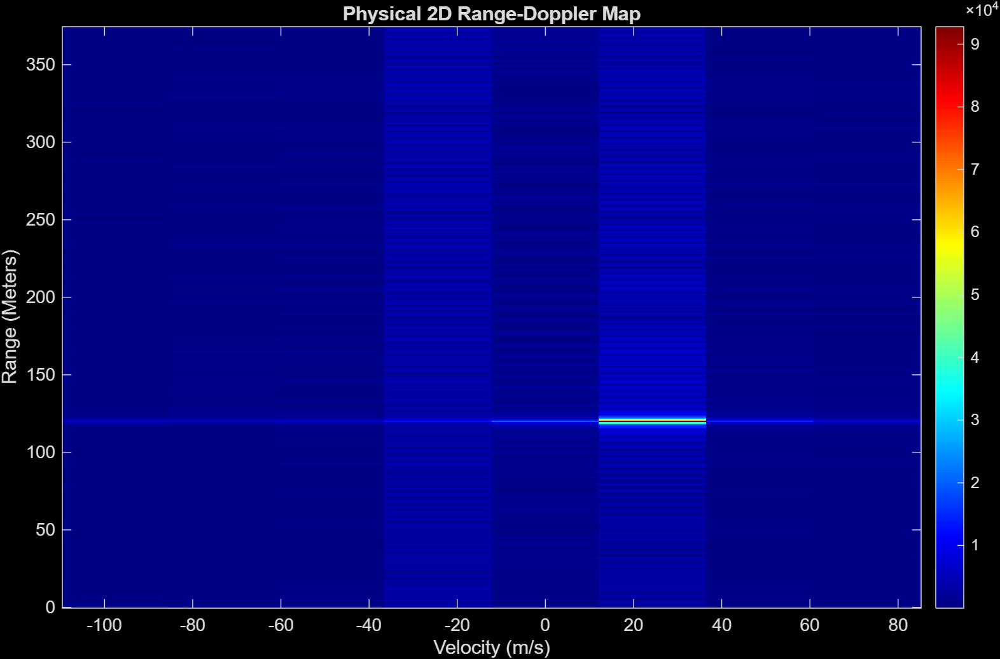
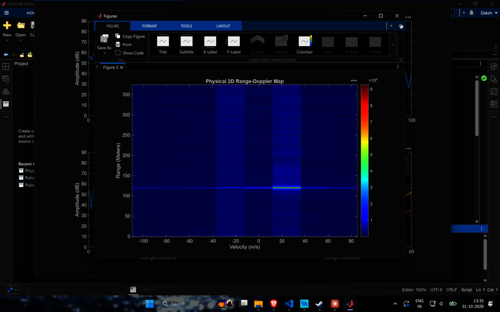

# 06 · Range-Doppler map

> Reshapes the 8 chirps into a matrix (fast time × slow time), does one FFT down the columns for range and one FFT along the rows for velocity.

**Input:** `out.rx_digital` (6001 values, the last 6000 are used)
**Output:** `RDM_magnitude` and the 2D plot (script `Range_Doppler_map.m`)

---

## Theory

A single chirp tells you the range but not the velocity. A moving target has a slightly different delay in each chirp, and what changes is the phase of the beat tone (the carrier term $2\pi f_c t_d$ from [03](03-mixer-filter-tvg.md)). From chirp $m$ to chirp $m+1$, the target has moved $v T_c$ so the phase rotates by

$$ \Delta\varphi = \frac{4\pi\,v\,T_c}{\lambda} = 2\pi f_d T_c $$

For $v$ = 20 m/s this is 0.645 rad (37°) per chirp. If I keep the range bin of the target in every chirp, I get 8 complex numbers that rotate by $\Delta\varphi$ each step. A second FFT over those 8 numbers is a frequency estimate of that rotation, i.e. the Doppler.

The matrix is

$$ X[n, m],\qquad n = 0\ldots749\ \text{(fast time)},\ m = 0\ldots7\ \text{(chirp)} $$

and the map is

$$ \text{RDM}[k, l] = \Big|\ \sum_{m=0}^{7} \Big(\sum_{n=0}^{749} X[n,m]\,e^{-j2\pi nk/750}\Big) e^{-j2\pi ml/8}\ \Big| $$

with `fftshift` along the Doppler axis so that zero velocity is in the middle.

### Axes

Velocity resolution:

$$ \Delta v = \frac{\lambda}{2\,N_{chirps}\,T_c} = \frac{3.896\times10^{-3}}{2\times8\times10\times10^{-6}} = 24.35\ \text{m/s} $$

Maximum unambiguous velocity:

$$ v_{max} = \frac{\lambda}{4T_c} = 97.4\ \text{m/s} $$

so the 8 velocity bins are −97.4, −73.0, −48.7, −24.35, 0, +24.35, +48.7, +73.0 m/s. Our 20 m/s lies at $20/24.35$ = 0.82 of a bin, so the nearest bin is +24.35 m/s (distance 0.18 bin), and the neighbouring zero bin is 0.82 bins away.

---

## How the script works

1. Take the last $N_{samples}\times N_{chirps}$ = 6000 values of `rx_digital` (the array has 6001: the first is the extra `t = 0` sample, which would shift every chirp by one sample, so I drop it by taking from the end).
2. `reshape(…, 750, 8)`, with each column one chirp.
3. `fft` down each column, keep rows 1 to 375.
4. `fft` along each row (8 points), `fftshift`.
5. `imagesc` with the physical axes.

One thing I noticed in the code: the range axis uses `range_res = c/(2*S*Tc)` which is $c/(2B)$ = 1 m per row. That is only right because the FFT length is 750 and $f_s/N$ = 100 kHz happens to be $S\cdot$(1 m round trip). If I changed `N_samples` it would stop being true. The correct general formula is $\Delta R = (f_s/N)\,c/(2S)$.

---

## Results

| Quantity | Expected | Measured |
|---|---|---|
| Range of the peak | 120 m | 120.00 m |
| Velocity of the peak | 20 m/s (between bins) | +24.35 m/s (nearest bin) |
| Peak magnitude, $G_{ADC}$ = 1 | not predicted | $9.279\times10^{4}$ |
| Peak magnitude, calibrated | 0.009763 × the above | $9.060\times10^{2}$ |

*Range–Doppler map of the first run. The peak is at 120 m in the +24.35 m/s column.*

*After ADC gain calibration. Same peak position, magnitudes scaled by 0.009763.*

*Screenshot of the real MATLAB figure.*

Since the target velocity (20 m/s) falls between two bins (0 and 24.35 m/s) the energy should be shared a bit by the 0 m/s column. I did not print the neighbouring bin values, so I cannot say how much of the energy ends up in the 0 m/s column. That would be the next thing to check, and also to repeat with a velocity that sits exactly on a bin, e.g. 24.35 m/s, to make sure the sign convention is right (positive = moving away is what `v_target` means in [02](02-target-and-echo.md); I have not checked that the map's positive side agrees with it).

---

## Limitations

- Only 8 chirps, so the velocity axis has 8 points, 24 m/s apart. A car radar would use 64 to 256 chirps for 1 m/s or better.
- No window on the Doppler FFT (the range FFT is also rectangular here).
- Peak magnitude is read by eye from the plot, and there is no detector.

---

[← 05 Range FFT and windowing](05-range-fft-windowing.md) · [Index](../README.md) · [07 Bit-depth sweep →](07-bit-depth-sweep.md)
