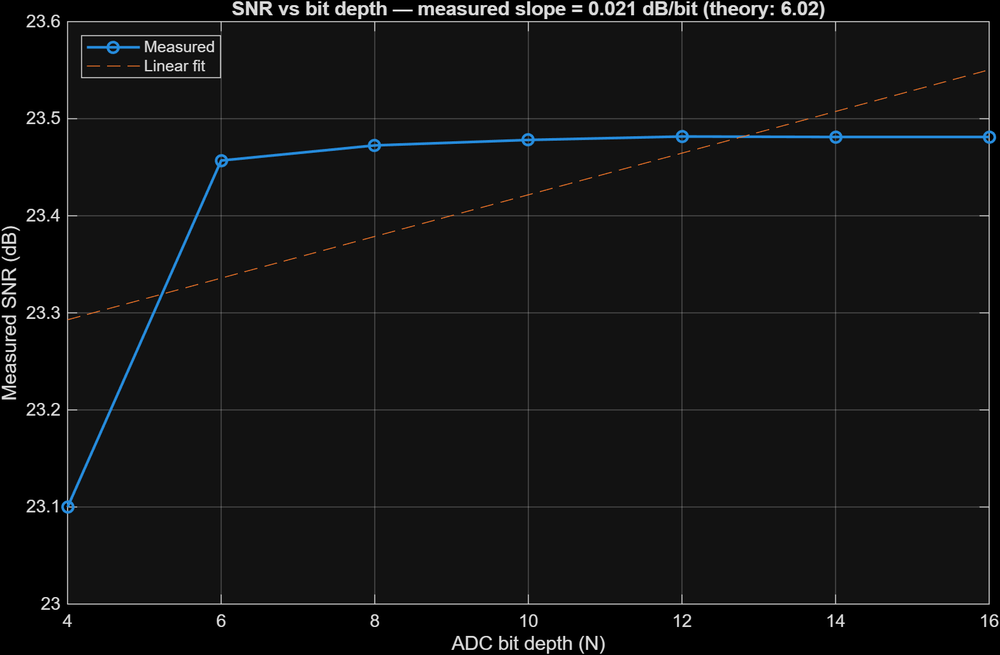
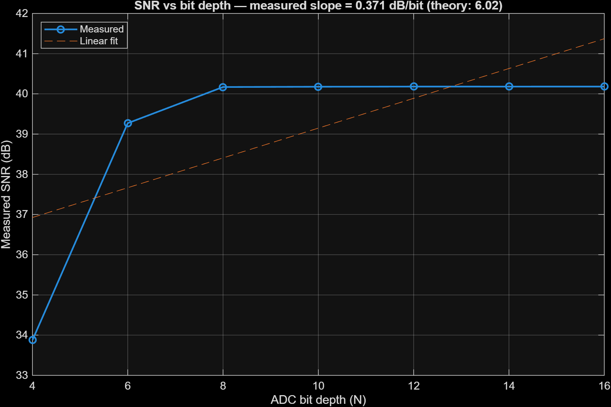
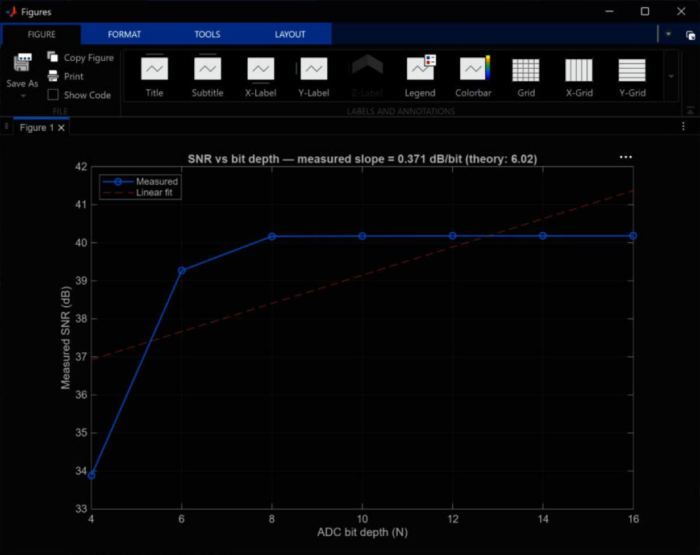

# 07 · Bit-depth sweep

> Runs the model for ADC resolutions from 4 to 16 bits and measures the SNR of the range FFT peak. The theory says 6.02 dB per bit. The model says almost nothing.

**Input:** the whole model, `Model.slx`, run once per bit depth
**Output:** SNR vs N plot (`run_bit_depth_sweep.m`; after the filter fix in [03](03-mixer-filter-tvg.md) it needs no change, because it calls `radar_init`)

---

## Theory

For a full-scale sine, quantisation noise alone gives

$$ \text{SNR} = 6.02\,N + 1.76\ \text{dB} $$

so every extra bit should add 6.02 dB until some other noise takes over. Then the curve flattens. That is what ADC "effective number of bits" is about. I expected a straight line at low N and a plateau at high N, with the knee telling me what the other noise is.

---

## How the script works

For each $N \in \{4, 6, 8, 10, 12, 14, 16\}$:

1. Set `N_bits` and `Delta_q = V_FSR/2^N`, run `sim('Model')`.
2. Take `ADC_output_logged`, chirp number 5 (750 samples), to skip the filter start-up.
3. Window with Blackman–Harris, FFT, power $P = |X|^2$.
4. Zero bins 1 to 5 (DC).
5. Peak power = max of $P$. Noise = mean of $P$ outside ±20 bins around the peak.
6. $\text{SNR} = 10\log_{10}(P_{peak}/P_{noise})$.

Then a straight line is fitted and its slope is shown in the title.

---

## Results

| N bits | SNR, original filter (dB) | SNR, filter fixed for $T_{step}$ (dB) |
|---|---|---|
| 4 | 23.10 | about 33.9 |
| 6 | 23.46 | about 39.3 |
| 8 | 23.47 | about 40.2 |
| 10 | 23.48 | about 40.2 |
| 12 | 23.48 | about 40.2 |
| 14 | 23.48 | about 40.2 |
| 16 | 23.48 | about 40.2 |
| fitted slope | 0.021 dB/bit | 0.371 dB/bit |

(The values are read off the plot axes, so the "about" ones are to roughly ±0.1 dB. The slopes are the numbers printed in the figure titles.)

*Original sweep. Flat at 23.5 dB from 6 bits onwards. The dashed line is the linear fit and the title says slope = 0.021 dB/bit (theory 6.02).*

*Screenshot of the same figure in MATLAB.*

*With the filter coefficients recomputed for the real step ($a = \omega_c T_{step}$). The plateau moves up to about 40.2 dB and starts at 8 bits instead of 6, but it is still flat.*

*Screenshot of the second run.*

---

## What this means

The ADC is not what limits the SNR here. Above 8 bits something else sets a floor that is about 24 dB (original) or 40 dB (fixed filter) below the peak, and a bigger ADC does not help. The filter fix moved the floor by about 17 dB, so a large part of the floor was the mixer sum term aliasing into the band (see [03](03-mixer-filter-tvg.md)). After the fix the floor is still there, and I do not know what it is.

The quantiser check in [04](04-adc.md) shows the quantiser behaves correctly, so I do not think the quantiser is wrong. Things that could still make the floor, from most to least likely in my opinion (all untested):

1. The TVG multiplies the tone by $t^2$, so the tone is amplitude modulated and its spectrum is spread over neighbouring bins. The estimator counts anything outside ±20 bins as noise, and a $t^2$ envelope has slowly decaying sidelobes.
2. Leakage of the Blackman–Harris window (it is very low, about −92 dB, so I doubt it is this).
3. The first 0.8 µs of every chirp contains the echo of the *previous* chirp ([02](02-target-and-echo.md)). It is a tone at a different frequency and it is not blanked.
4. The estimate itself: peak bin power divided by the *mean* of the other bins, which counts a few strong leakage bins heavily.
5. There is no thermal noise in the model, so there is no "real" noise to limit the SNR.

The honest conclusion is that this sweep does not test the ADC. To see 6 dB per bit I would have to lower the other floor first (blank the first 0.8 µs, remove the TVG, or use a coherent-gain-corrected estimate), and add a noise source if I want to find the point where the ADC stops mattering.

One more check I want to do: `blackmanharris` also comes from the Signal Processing Toolbox, and I already know that another function of mine (`hamming`) is shadowed by an old SAR project (see [05](05-range-fft-windowing.md)). I should run `which blackmanharris -all` to be sure the sweep uses the right window.

---

## Check

| Quantity | Expected | Measured |
|---|---|---|
| Slope | 6.02 dB/bit | 0.021 dB/bit (original), 0.371 dB/bit (filter fixed) |
| SNR at 12 bits | up to 74 dB | 23.5 dB (original), 40.2 dB (filter fixed) |
| Quantiser error (std) at 12 bits | 1.410e-4 V | 1.394e-4 V ([04](04-adc.md)) |

---

[← 06 Range-Doppler map](06-range-doppler-map.md) · [Index](../README.md) · [08 Issues and open questions →](08-issues-and-open-questions.md)
