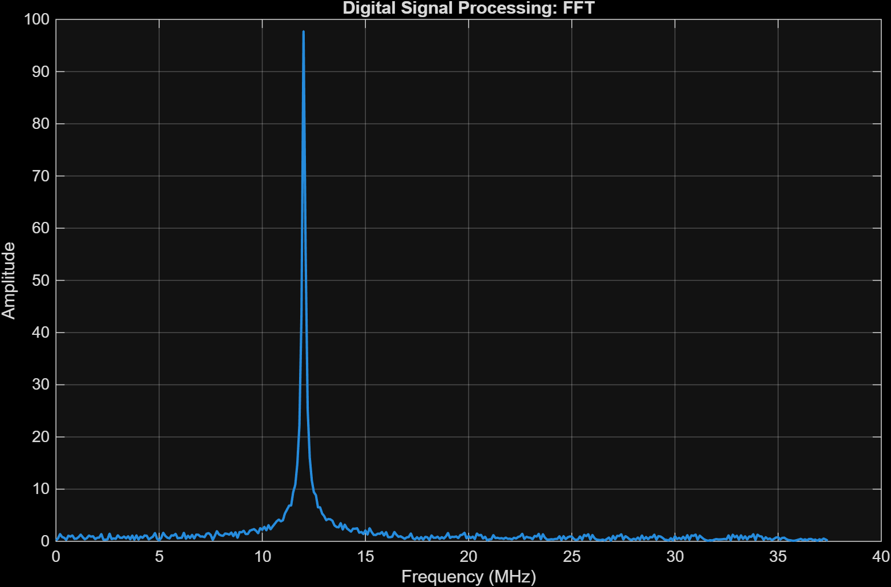
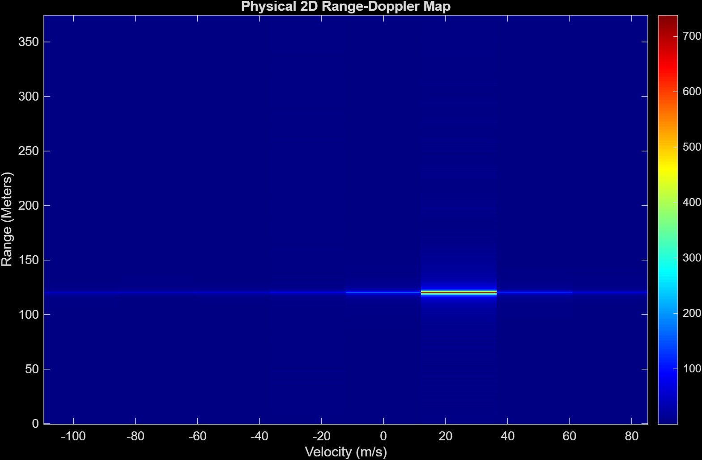
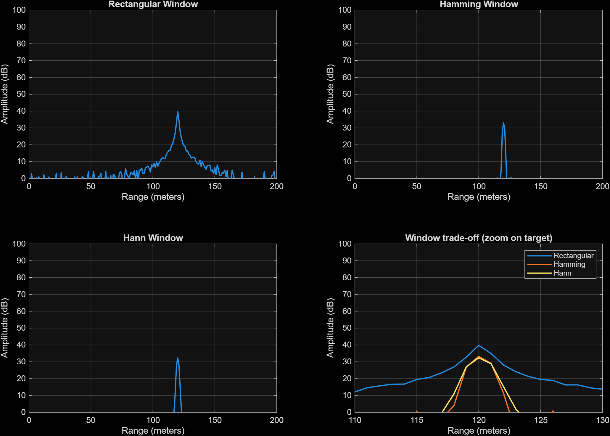

# 08 · Issues and open questions

> Everything I found while running the project that looks wrong, odd or unverified. I only read and ran the original project. I did not change any of the original files.

Status words: **confirmed** = I measured it. **Unclear** = I have a question but no answer yet. Hypotheses are marked as hypotheses.

---

## 1. Low-pass filter runs at the wrong sample time (confirmed)

`radar_init.m` designs the filter for $T_s$ = 13.33 ns but the `Discrete Transfer Fcn` block has `SampleTime = -1` and the compiled model runs it at $T_{step}$ = 0.667 ns. The real cutoff is around 300 MHz, not 18 MHz. Tests with the corrected coefficients raised the SNR plateau from 23.5 dB to 40.2 dB. Details: [03](03-mixer-filter-tvg.md), [07](07-bit-depth-sweep.md).

Two ways to fix it, either of which should work (not applied):

- set the block's `SampleTime` to `Ts`, so that the filter runs at the ADC clock, or
- keep it at $T_{step}$ and design the coefficients with `a = w_c*T_step`.

The first one is closer to the real hardware (a real filter is analogue, though, so the second is a better model of that). There is also a small thing: Tustin without pre-warping gives −4.07 dB at 18 MHz instead of −3 dB.

## 2. `hamming` is shadowed by a function from another project (confirmed)

`which hamming` points to a `hamming.m` in my old SAR project folder (`...\mlradar\libs\ambiguity\hamming.m`) which returns a row vector. In `windowing.m` this broadcasts to a 750×750 matrix and the Hamming plot is just the rectangular one minus 21.94 dB. Fixed in `windowing.m`. Corrected peaks: Rectangular 41.81 dB, Hamming 35.30 dB, Hann 34.42 dB. See [05](05-range-fft-windowing.md).

What I would do: run `which hamming -all`, then remove the SAR folder from the path (or rename its `hamming.m`). `blackmanharris` in the sweep should be checked in the same way.

## 3. What does `V_FSR` mean? (unclear)

`Delta_q = V_FSR/2^N` treats $V_{FSR}$ as the full span, but the calibration puts the *peak* at $0.8\,V_{FSR}$ = 1.6, which would be out of range for a ±1 V span. The `Quantizer` does not clip, so the model cannot show it. Either the peak target should be $0.8\,V_{FSR}/2$ or `V_FSR` is meant to be the peak amplitude and $\Delta$ should be $2V_{FSR}/2^N$. See [04](04-adc.md). If I add a `Saturation` block in front of the quantiser, the problem would show up in the sweep.

## 4. No saturation in the ADC (confirmed)

Related to 3. With $G_{ADC}$ = 1 the ADC input peaked at about 164 and the model still gave a clean 120 m result. A real converter would have clipped it. It is correct that the Simulink `Quantizer` does not clip, but it means the model is optimistic about the dynamic range.

## 5. TVG in an FMCW chain (unclear)

The gain $C\,t_{fast}^2$ compensates $1/R^2$ in a pulsed radar, where time = range. After dechirping, range is the *frequency* of the beat tone, so every target at a given instant gets the same gain. It only modulates the tones. Should it be there? Maybe it was meant as a model of an IF gain ramp, or this is a step from the roadmap that does not transfer. I would test by turning it off and re-running the sweep (that is also hypothesis 1 in [07](07-bit-depth-sweep.md)).

## 6. The first 0.8 µs of each chirp (confirmed from the structure, effect not measured)

The delayed phase carries over from the previous chirp, so the first $t_d$ = 0.8 µs (8 % of the samples) has the previous chirp's tail in it, mixing to a different frequency. It is physically right but adds a broadband smear. Normal radars discard these samples.

## 7. Velocity resolution (confirmed, expected)

With 8 chirps, $\Delta v$ = 24.35 m/s. A 20 m/s target is shown at +24.35 m/s. Not a bug, but the map is not useful for velocity until the chirp count goes up. See [06](06-range-doppler-map.md).

## 8. `windowing.m` is for the old target (confirmed)

Its x-axis goes to 50 m but the target is at 120 m. Fixed in `windowing.m` (axes, plus the fix from 2).

## 9. `Scope2` shows a flat line (confirmed, not a bug)

Manual y-limits of about ±1.4×10⁷. The signal is at ±1.6. See [04](04-adc.md).

## 10. `Range_Doppler_map.m` range axis formula (unclear)

`range_res = c/(2*S*Tc)` gives 1 m only because $f_s/N$ = 100 kHz happens to match. It should be `(fs/N_samples)*c/(2*S)`. Same number now, but it would silently break if `N_samples` or the clock divider changed.

## 11. Remaining SNR plateau after the filter fix (unclear)

Flat at 40.2 dB above 8 bits. Hypotheses only: TVG modulation, the unblanked first 0.8 µs, the estimator, and no thermal noise. See [07](07-bit-depth-sweep.md).

## 12. Sign of the Doppler axis (unclear)

I did not test whether a target moving *towards* the radar appears at negative velocity. Needs one more run with `v_target = -24.35`.

---

## Fixes

The two confirmed problems (1 and 2) are fixed (issue 1 in `radar_init.m`, issue 2 in `windowing.m`). `Model.slx` is unchanged.

- `radar_init.m`: the filter is designed for the rate the block runs at, `a = w_c * T_step` (0.0754 instead of 1.508), giving `num = [0.0363 0.0363]`, `den = [1 -0.9273]`. The model itself needs no change.
- `windowing.m`: Hamming and Hann are written out as formulas (`0.54-0.46cos(2πn/(N-1))` and `0.5-0.5cos(2πn/(N-1))`) and forced to columns, so a shadowing `hamming.m` on the path cannot break it. I did not touch the MATLAB path.

I re-ran the model with the fixed `radar_init.m` (ADC gain 0.009763 from the earlier calibration) and the original analysis scripts:

| Quantity | Before (original filter) | After (filter fixed) |
|---|---|---|
| Beat frequency / range | 12.00 MHz / 120.00 m | 12.00 MHz / 120.00 m |
| Max of `rx_digital` | 1.5915 | 0.8032 |
| Range-Doppler peak | 906.0 at 120 m, +24.35 m/s | 738.2 at 120 m, +24.35 m/s |
| Window peaks (Rect / Hamming / Hann) | 41.81 / 35.30 / 34.42 dB | 39.80 / 33.25 / 32.36 dB |
| Median level away from the target | 15.2 / 9.5 / 8.4 dB | −2.6 / −10.9 / −11.1 dB |
| Peak minus floor | 26.6 / 25.8 / 26.1 dB | 42.4 / 44.1 / 43.5 dB |

The target is found at the same place and the floor drops by 17 to 19 dB, so most of the old "noise" was the unfiltered mixer sum term aliasing. The peak gets smaller because that sum term used to add to it. The max of `rx_digital` fell to almost exactly half, which is 80 % of a ±1 V span. That is only because the gain was calibrated on the old signal, so it does not settle question 3 ($V_{FSR}$); I should re-run `calibrate_adc_gain` with the new filter and decide the convention first.

*Range FFT with the filter fixed. One clean peak at 12 MHz and a flat floor.*

*Range-Doppler map with the filter fixed.*

*`windowing.m`: Hamming and Hann now fall to the floor within a few metres of the target, and the rectangular window shows its wide leakage skirt.*

Still not fixed because they need a decision from me: items 3, 4, 5, 6, 10 and 12, and the flat sweep (11) needs to be re-run with the fixed `radar_init`.

---

## What was changed in the repository

- `radar_init.m`: one line, `a = w_c * T_step` (the filter fix, issue 1).
- `windowing.m`: windows written as formulas and forced to columns (issue 2), axes moved to the 120 m target.
- `run_bit_depth_sweep.m` and `calibrate_adc_gain.m` are unedited; they pick up the filter fix through `radar_init`. `Model.slx` is unchanged.
- `docs/scripts/` holds the helper scripts used for these notes: `plot_logged_signals.m` and `extra_plots.m`.

---

[Index](../README.md) · [← 07 Bit-depth sweep](07-bit-depth-sweep.md)
